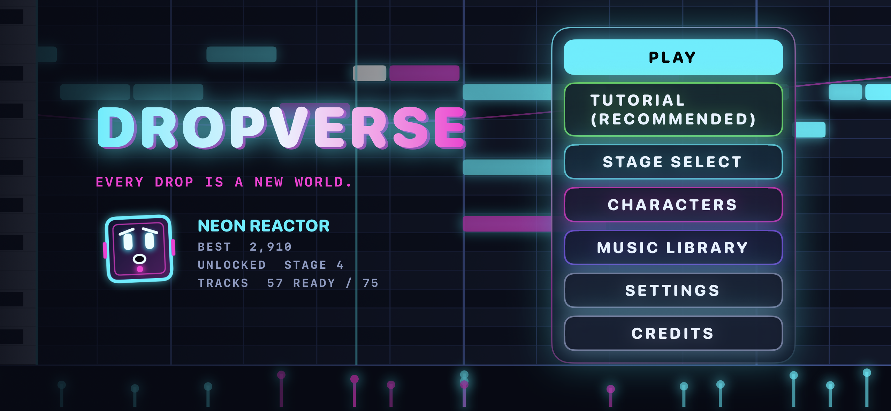
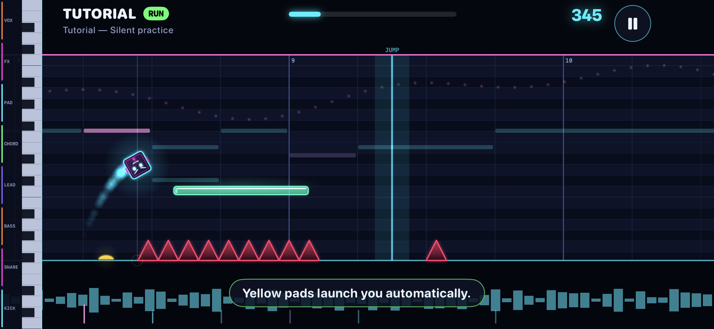
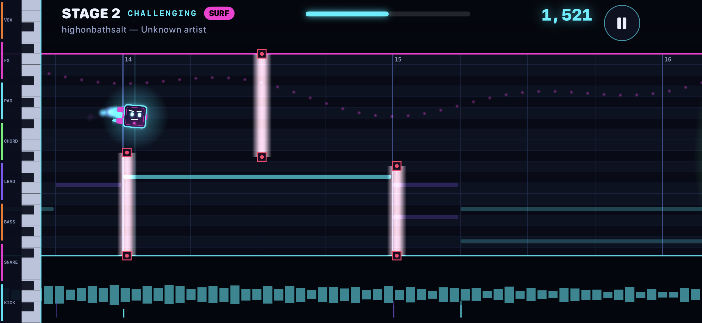

# DROPVERSE

**Every drop is a new world.**

DROPVERSE is an iPhone rhythm-platformer that combines fast-paced obstacle gameplay with electronic music and an FL Studio-inspired piano-roll environment. Navigate beat-synchronized stages, time your jumps, and switch between gameplay modes in a neon MIDI world.



## Features

- **Rhythm-based gameplay:** Navigate obstacles, platforms, pads, and lasers in stages built around musical timing.
- **Multiple gameplay modes:** Play through Runner-style sections and Surfer sections, with additional modes introduced as stages progress.
- **Double jump and responsive controls:** Tap to jump again in mid-air; hold to adjust jump height in supported modes.
- **Progressive difficulty:** Procedurally assembled obstacle patterns with increasingly challenging stages.
- **MIDI-inspired visuals:** Scrolling note lanes, piano-roll grids, neon effects, and optional beat/tap timing guides.
- **Customizable characters:** Choose from four cosmetic cube designs with distinct expressions and effects.
- **Music library:** Browse available tracks and view information such as BPM and drop segments.

## Screenshots

### Gameplay

| Tutorial | Surf Mode |
|:---:|:---:|
|  |  |

### Customization and Music

| Character Selection | Music Library |
|:---:|:---:|
|  |  |

## Built With

- **Swift** — Application and game logic
- **SpriteKit** — 2D game rendering and gameplay scenes
- **SwiftUI** — Menus, settings, and interface
- **AVFoundation** — Audio playback and timing
- **Python** — Supporting simulation and level-validation tools

## Getting Started

1. Clone the repository:

   ```bash
   git clone https://github.com/Akira5298/DROPVERSE.git
   cd DROPVERSE
   ```

2. Open the Xcode project in Xcode. If the repository uses an XcodeGen `project.yml` instead of a generated Xcode project, run `xcodegen generate` first.
3. Choose an iPhone simulator or connected iPhone, then build and run the app.

Some tracks may require local audio assets and appropriate usage rights. See the project configuration and music resources for the current setup.

## Development Notes

The project includes custom deterministic physics, obstacle-pattern validation, jump timing assistance, and regression checks for pit rendering and edge landings. For the detailed v0.3 implementation notes and verification limitations, see [Development Notes](docs/DEVELOPMENT_NOTES_v0.3.md).

**Verification note:** The supplied v0.3 development notes report Python simulation checks, but do not confirm that the Swift project was compiled or tested on an iPhone in that environment.
